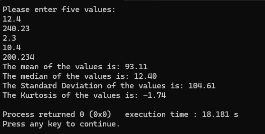

# C programozás

## Áttekintés

Ez a repository három programozási feladatot tartalmaz, amelyeket az egyetemi tanulmányaim első évében készítettem. A projekteket C programozási nyelven fejlesztettem, és segítségükkel bővítettem a programozási alapokkal, a problémamegoldással és a felhasználói adatbevitel kezelésével kapcsolatos ismereteimet.

A feladatok a jelszóellenőrzést, a karakterláncok kezelését, a rekurziót és a statisztikai számításokat mutatják be.

## Projektek

### 1. feladat – Jelszóellenőrzés

Egy egyszerű jelszóellenőrző program, amely arra kéri a felhasználót, hogy adjon meg egy jelszót, majd összehasonlítja azt egy előre meghatározott jelszóval.

**Bemutatott programozási ismeretek:**
- Karaktertömbök és karakterláncok kezelése
- Felhasználói adatbevitel a `scanf()` függvénnyel
- Karakterláncok összehasonlítása a `strcmp()` függvénnyel
- `while` ciklusok
- `if/else` feltételes utasítások

A program addig kéri újra a jelszót, amíg a felhasználó meg nem adja a helyes értéket.

### 2. feladat – Országnevek és magánhangzók számlálása

Egy program, amely lehetővé teszi a felhasználó számára, hogy tíz országnevet adjon meg egy előre meghatározott listából. A program ezt követően meghatározza a leghosszabb és a legrövidebb országnevet, valamint megjeleníti a bennük található magánhangzók számát.

**Bemutatott programozási ismeretek:**
- Karakterláncok és karaktertömbök kezelése
- A `strlen()` függvény használata a karakterláncok hosszának meghatározására
- Rekurzív függvények
- Magánhangzók felismerése feltételes utasításokkal
- Értékek összehasonlítása `if/else` utasítások segítségével
- Kis- és nagybetűs magánhangzók felismerése, beleértve az Y betűt is

A `Vowelcount()` nevű rekurzív függvény karakterenként vizsgálja meg az országneveket, és meghatározza a bennük található magánhangzók számát.

### 3. feladat – Statisztikai számítások

Egy program, amely öt numerikus értéket kér be a felhasználótól, majd különböző statisztikai mutatókat számít ki.

**Megvalósított számítások:**
- Számtani átlag
- Medián
- Sokasági szórás
- Sokasági excessz csúcsosság (kurtózis)

**Bemutatott programozási ismeretek:**
- Tömbök használata
- Értékek rendezése a `qsort()` függvénnyel
- Összehasonlító függvények
- `for` ciklusok
- Matematikai számítások
- A `math.h` könyvtár és a `sqrt()` függvény használata

A medián meghatározásához a program növekvő sorrendbe rendezi az öt megadott értéket. A szórás és az excessz kurtózis kiszámítása az átlag és a variancia felhasználásával történik.

## Fejlesztett készségek

A feladatok elkészítése során gyakorlati tapasztalatot szereztem a következő területeken:

- C programozási alapok
- Változók, adattípusok és tömbök használata
- Felhasználói adatbevitel és kimenet kezelése
- Feltételes utasítások és ciklusok
- Függvények és rekurzió
- Karakterláncok kezelése
- Adatok rendezése és összehasonlítása
- Matematikai és statisztikai számítások
- Hibakeresés és programok tesztelése

## Összegzés és tapasztalatok

Ezek a feladatok segítettek jobban megérteni, hogyan alkalmazhatók a programozási alapelvek különböző problémák megoldására.

A 2. feladat során tapasztalatot szereztem a rekurzió és a karakterláncok kezelésében, míg a 3. feladat segített megérteni a C szabványos könyvtárában elérhető rendezési függvények használatát, valamint a statisztikai számítások programozott megvalósítását.

Emellett tapasztalatot szereztem a hibák felismerésében, a különböző bemeneti értékekkel történő tesztelésben és a kód továbbfejlesztésében, ahogy bővültek a C nyelvvel kapcsolatos ismereteim.

## Megjegyzések

Ezek a projektek egyetemi kurzusfeladatok alapján készültek, és a C programozási nyelv tanulása során elért fejlődésemet mutatják be. A programok oktatási és tanulási célokat szolgáló feladatok.
